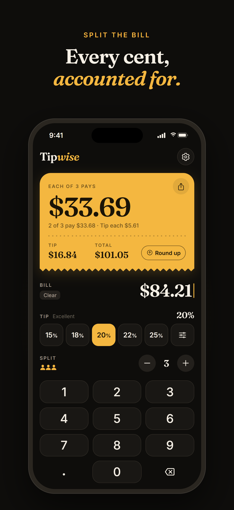
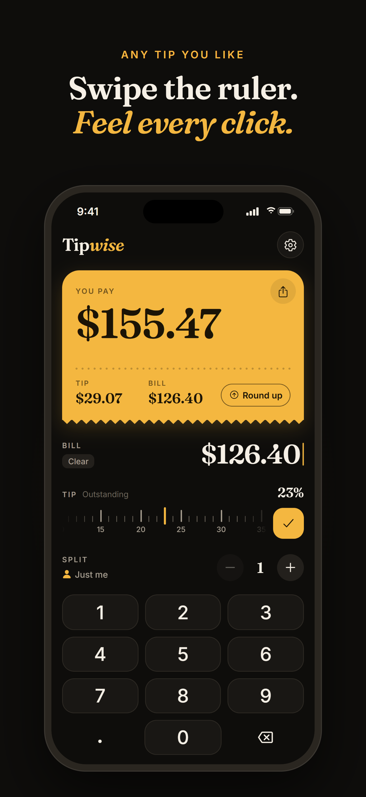
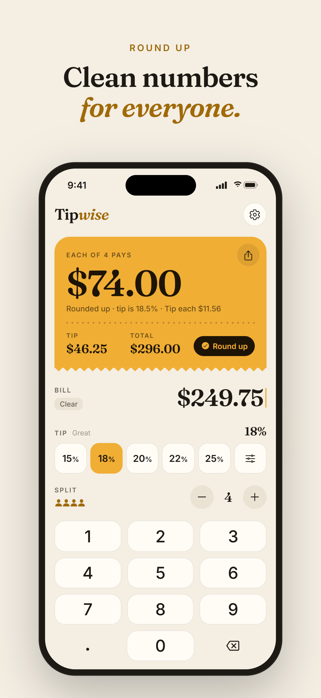
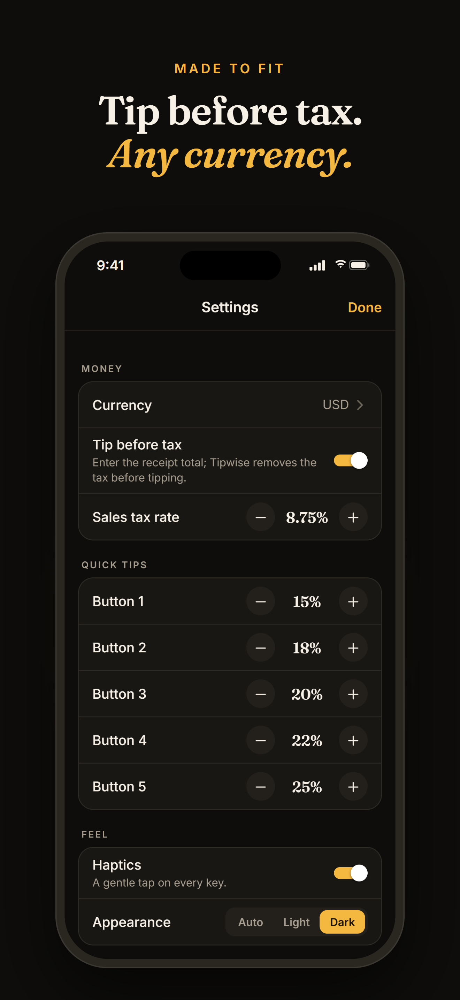
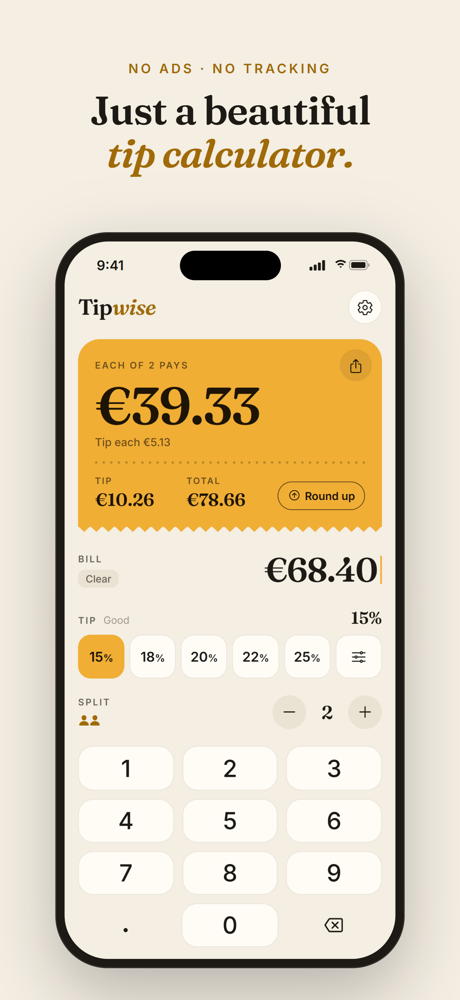

<p align="center"></p>

<h1 align="center">Tipwise</h1>
<p align="center"><b>Tip &amp; split, to the cent.</b> A calm, beautiful tip calculator for iPhone, built with Expo.</p>

<p align="center">
  
  
  
  
  
</p>

## Features

- **Exact splits.** All math runs in integer cents. When a bill doesn't divide evenly, Tipwise says who pays the extra cent, so the shares always add up to the total.
- **Round up.** One tap rounds each person's share up to a whole amount and shows the real tip percentage that results.
- **Tip ruler.** Quick tips (editable) plus a swipeable ruler with a haptic click per percent.
- **Tip before tax.** Enter the receipt total and Tipwise backs out the sales tax before tipping.
- **Any currency.** Follows the device region or pick from 27 currencies; zero-decimal currencies (JPY, KRW…) are handled.
- **Light & dark**, haptics, VoiceOver labels, share sheet, remembered preferences.
- **Private.** No ads, no analytics, no network calls. See [PRIVACY.md](PRIVACY.md).

## Develop

```bash
npm install
npm run web        # or: npx expo start, then open in Expo Go
npm test           # money/split logic tests (Node 22.18+)
npm run typecheck
```

Project layout:

| Path | What |
| --- | --- |
| `App.tsx` | Fonts, splash, theme and providers |
| `src/Calculator.tsx` | The main screen |
| `src/money.ts` | Formatting, keypad rules and the tip/split math |
| `src/components/` | Keypad, result card, tip ruler, stepper, settings sheet |
| `design/` | Icon (`npm run icons`) and App Store screenshot (`design/screenshots.js`) generators |
| `store.config.json` | App Store listing (EAS Metadata) |

## Release to the App Store

Requires an [Apple Developer Program](https://developer.apple.com/programs/) membership and a free [Expo](https://expo.dev) account.

```bash
npx eas-cli@latest login
npx eas-cli@latest init                                   # links the project, adds its id to app.json
npx eas-cli@latest build -p ios --profile production --auto-submit   # cloud build → TestFlight
npx eas-cli@latest metadata:push                          # listing, keywords, age rating, screenshots
```

Then in [App Store Connect](https://appstoreconnect.apple.com): set the price (Free), answer App Privacy with **Data Not Collected**, attach the build to version 1.0 and **Submit for Review**.
